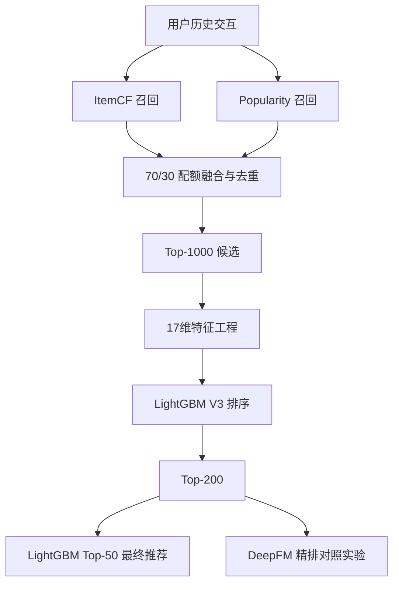

# KuaiRec 短视频个性化推荐系统

基于 KuaiRec 数据集构建的离线短视频推荐系统，涵盖多路召回、候选排序、DeepFM 对照实验及独立测试评估。

## 1. 项目概述

- 数据规模：约 1,253 万条用户-视频交互，7,176 名用户，10,728 个视频。
- 正向标签：watch_ratio > 1。
- 数据划分：全局时间顺序划分 Train / Val / Test。
- 技术栈：Python、Pandas、NumPy、SciPy、LightGBM、PyTorch。

## 2. 系统架构



DeepFM 作为验证集对照方案，未纳入最终主推荐链路。

## 3. 核心技术

### 多路召回

- Popularity：根据历史正向交互用户数构建热门榜。
- ItemCF：基于稀疏用户-物品矩阵计算余弦相似度，每个物品保留 Top-100 邻居。
- Fusion：采用 70/30 初始配额融合，进行去重、历史交互过滤与候选补齐。

### LightGBM 候选排序

采用候选级监督训练，利用历史数据生成候选，根据未来正向交互构造标签。

共构建 17 个特征：

| 特征类别 | 数量 |
| --- | ---: |
| 召回信号 | 8 |
| 用户历史行为 | 3 |
| 视频类别属性 | 3 |
| 用户类别偏好 | 3 |

训练集包含 80 万条候选样本，内部验证集包含 20 万条候选样本。

### DeepFM 对照实验

采用 PyTorch 实现 FM 与 DNN 联合学习，通过 4 折 OOF 构造 16 万条折外粗排候选训练样本。

在当前特征与训练方案下，DeepFM 未超过 LightGBM，因此保留 LightGBM 作为最终排序模型。

## 4. 实验结果

### 独立 Test

测试阶段使用 Train + Val 历史重建召回器及用户特征，冻结 LightGBM 模型参数。

评价包含 6,898 名目标用户及 431,482 个新正向用户-视频对。

| 指标 | Fusion | LightGBM V3 | 相对提升 |
| --- | ---: | ---: | ---: |
| Macro Recall@1000 | 0.2308 | 0.2308 | - |
| Macro Recall@200 | 0.0620 | 0.0808 | 30.3% |
| Macro Recall@50 | 0.0122 | 0.0189 | 54.7% |
| Macro NDCG@50 | 0.0198 | 0.0305 | 54.0% |

用户级配对 Bootstrap 结果：

| 指标 | 平均提升 | 95% CI |
| --- | ---: | --- |
| Recall@200 | 0.018761 | [0.017430, 0.020108] |
| Recall@50 | 0.006696 | [0.006019, 0.007349] |
| NDCG@50 | 0.010701 | [0.009715, 0.011731] |

### DeepFM 验证集对照

| 模型 | Val Macro Recall@50 |
| --- | ---: |
| LightGBM V3 | 0.023531 |
| DeepFM V1 | 0.022855 |
| DeepFM V2 | 0.023003 |

### 工程与复现

- 完成模型持久化、独立推理及模块化整理。
- LightGBM V3 独立重训后与原模型预测一致。
- 重新生成 717.6 万条 Test 候选及 358,800 条 Top-50 推荐记录，核心指标与原实验一致。

## 5. 项目结构

```text
KuaiRec-Recommendation/
├── configs/       # 实验配置及路径模板
├── data/          # 训练样本与历史状态构建
├── recall/        # Popularity、ItemCF、Fusion
├── ranking/       # 特征工程、LightGBM、DeepFM
├── evaluation/    # 指标计算与实验评估
├── artifacts/     # 模型产物打包工具
├── tests/         # 协议测试
├── recommend.py   # 统一命令入口
└── README.md
```

## 6. 环境与数据

安装实验依赖：

```bash
pip install -r requirements-experiments.txt
```

仅使用 LightGBM 推理时，可参考 requirements-inference.txt。

数据集下载：

- [KuaiRec 官方仓库](https://github.com/chongminggao/KuaiRec)
- [KuaiRec 原论文](https://arxiv.org/abs/2202.10842)

本仓库不分发原始数据集、模型权重及大型中间实验产物。

## 7. 使用说明

查看命令帮助：

```bash
python recommend.py --help
```

查看训练及评估命令说明（不执行实际训练）：

```bash
python recommend.py train-v3 --explain
python recommend.py test-end-to-end --explain
```

configs/ 中提供了 example.json 配置模板，需要根据本地数据及模型产物位置配置。

当前公开版主要用于展示算法实现与已完成的实验结果。完整训练复现和 Test 审计仍依赖原始实验参考产物；尚未实现从原始数据到全部模型的一键构建，也未验证跨机器完整复现。DeepFM 独立重训命令尚未迁移。

## 8. 局限与后续方向

- 历史正向物品库无法覆盖 23.89% 的 Test 新正向目标。
- 未观测正向交互作为弱负例，存在曝光偏差。
- 固定历史快照评估无法完整模拟线上实时兴趣变化。
- 后续可探索内容召回、双塔召回及更丰富的排序特征。

本项目为离线推荐算法实验，不涉及实际线上推荐服务部署或 A/B 测试。
